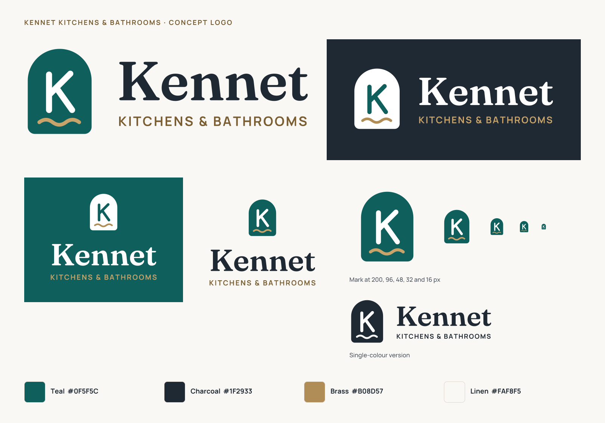

# Kennet brand: concept logo

## The idea

**An arched doorway.** The mark is a rounded arch, the shape of a doorway into a room and of the arched mirrors in many of today’s bathrooms. It also nods to the period homes Kennet works on, from Victorian terraces in Old Town to Cotswold cottages.

**A K monogram.** Drawn with the same round-ended strokes in every version, so it stays legible at favicon size.

**A brass wave.** The River Kennet, which runs through Marlborough and gives the business its name. It doubles as a hint of water, for the bathroom side of the business.

**The wordmark.** “Kennet” is set in Fraunces SemiBold, a soft, warm serif that feels crafted rather than corporate. The tagline “KITCHENS & BATHROOMS” is set in Manrope Bold, letter-spaced so it spans exactly the width of “Kennet”.

All text is converted to vector outlines. The logo renders the same everywhere, including in email signatures, PDFs, favicons and social previews where the web fonts aren’t available.

## Files

All in `public/brand/` and generated by `npm run assets` (`scripts/generate-assets.mjs`):

| File | Use |
| --- | --- |
| `kennet-logo-horizontal.svg` | Default logo on light backgrounds (site header) |
| `kennet-logo-horizontal-reversed.svg` | On charcoal or teal backgrounds (site footer) |
| `kennet-logo-horizontal-mono.svg` | Single-colour print: vans, embroidery, stamps |
| `kennet-logo-stacked.svg` / `-reversed.svg` | Square-ish spaces: signage, social posts |
| `kennet-mark.svg` / `-reversed.svg` | The mark on its own: favicon, app icon, social avatar |
| `kennet-logo-horizontal.png` | 1200 px PNG for documents and email signatures |
| `kennet-profile-800.png` | 800 px square avatar for Google Business Profile and social media |

Also generated: `favicon.svg`, `favicon.ico`, `apple-touch-icon.png`, `logo.png` (used in the LocalBusiness schema) and the six Open Graph images in `public/og/`.

## Colours

| Name | Hex | Use |
| --- | --- | --- |
| Teal | `#0F5F5C` | The mark, primary buttons |
| Charcoal | `#1F2933` | Wordmark, body text, dark backgrounds |
| Brass | `#B08D57` | The wave, decorative rules. Not for small text on light backgrounds |
| Brass (text) | `#7A5E32` | Tagline on light backgrounds (5.7:1 contrast) |
| Brass (light) | `#C9A46A` | Tagline and wave on dark backgrounds |
| Linen | `#FAF8F5` | Page background |

## Usage

- **Clear space:** at least the width of the K’s stem × 4 (roughly a quarter of the mark’s width) on every side.
- **Minimum size:** the horizontal logo at 120 px wide on screen, 30 mm in print. Below that, use the mark on its own.
- **Don’t** recolour the wave, stretch the lockup, add effects, or reset the wordmark in another typeface.

## Changing it

The mark is defined once in `scripts/generate-assets.mjs` (`markShapes`), on a 40 × 52 grid. Edit it there, adjust the colours in `C` or `THEMES`, run `npm run assets`, and every file above is regenerated.
